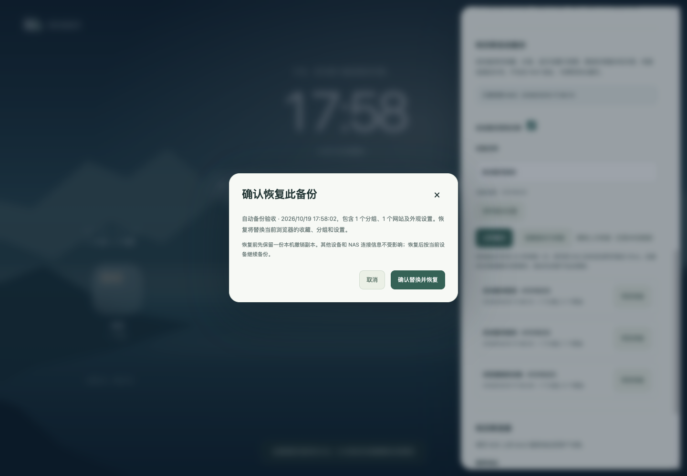
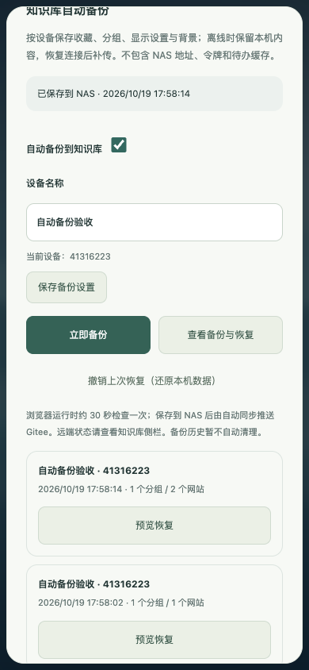

# 浏览器工作台自动备份（Chrome 0.5.0 / kbcli 0.1.3）

收藏、分组、排序、三个浏览偏好和外观设置自动备份到用户连接的知识库。自定义 WebP 背景按内容去重保存。NAS 地址、用户/agent 令牌、待办和知识缓存、设备身份、撤销副本不进入备份。浏览器运行时自动备份默认开启，可在设置中关闭；关闭后仍可手动备份。

## 使用

1. 重新加载新版扩展，打开设置，连接现有 NAS 服务（用户令牌）。
2. 在“知识库自动备份”中填写设备名称；设备 ID 由每个浏览器配置独立生成，卸载重装后会生成新 ID。
3. 修改收藏或外观后，约 30–60 秒保存到 NAS；也可以点击“立即备份”。保存到 NAS 与推送 Gitee 是两个阶段，后者看知识库的同步状态。
4. “查看备份与恢复”展示最近 100 条各设备快照。选择“预览恢复”，核对来源和数量，确认后替换本机收藏和设置。NAS 连接和当前设备身份不变。
5. 恢复前先存本机撤销副本；若空间不足则不改当前数据。可点击“撤销上次恢复”取回原数据。撤销与恢复都会成为当前设备后续备份的内容。





## 持久化与离线

`chrome.alarms` 每 30 秒唤醒检查，worker 每次启动检查并重建丢失的 alarm；不依赖常驻页面计时器或内存 outbox。Chrome 可能延迟 alarm，浏览器关闭/电脑睡眠时不会持续上传，恢复运行后补传。官方行为见 [alarms](https://developer.chrome.com/docs/extensions/reference/api/alarms) 与 [worker 生命周期](https://developer.chrome.com/docs/extensions/develop/concepts/service-workers/lifecycle)。兼容 Chrome 120，不依赖 Chrome 150 的 persistAcrossSessions。

`storage.local.backup` 持久化设备身份、开关、已确认指纹和待传备份 ID、数据指纹、连接版本、重试次数、下次时间，不重复存整张背景。发送时读取当前规范数据；离线期间多次修改合并为最新状态，不保存每一次点击的中间历史。上传期间的新编辑不会被旧应答标成已备份。

失败按 30 秒起步指数退避，最高 30 分钟；手动备份跳过等待。结果不确定时，同一份数据重用相同设备/备份 ID；服务端只允许同内容重放，不覆盖已有快照。数据、连接版本改变后创建新 ID。这里的安全重试仅适用于幂等备份，待办写入仍不自动重放。

## 知识库文件

```text
assets/app-backups/chrome-kb/
  devices/<device-uuid>/<backup-uuid>.json
  wallpapers/<sha256>.json
```

快照为 `kb-workspace-backup` v1；仅保存明确字段，服务端拒绝未知字段、含账号密码的网址和非 HTTP(S) 网址。壁纸文件为包含一个 dataURL 的 JSON，小于 2 MiB，按规范 JSON 的 SHA-256 寻址；每份快照只保存 hash 和图片名称。同一图片不因收藏修改重复存储。附件不参与 Markdown 发现、Schema 和检索统计。

备份总请求上限 4 MiB、最多 100 分组/2000 收藏；沿用本地壁纸上限。UUID v4 严格匹配，路径固定且拒绝符号链接。快照不可覆盖、不可通过 API 删除。本版历史只追加，列表默认最多 100 条（接口最多 200 条），暂不自动清理。Git 历史也会保留被人工删除的旧快照；这不是加密存储。不要手改备份文件，篡改、脏索引或未知修改会暂停同步。

## 服务端与同步

所有接口仅接受 human 用户令牌，agent 无权读写。无 CORS 放开、任意路径/URL 代理、远程脚本或新增容器。

| 接口 | 用途 |
|---|---|
| `POST /api/backups/chrome` | `{device_id,backup_id,device_name,payload}`；同 ID 同内容幂等 |
| `GET /api/backups/chrome?limit=100` | 仅返回来源、时间、分组和收藏数量 |
| `GET /api/backups/chrome/{device}/{backup}` | 读取快照并还原壁纸引用 |

`Operations.write_backup` 只创建白名单 JSON，使用写锁、prepared → saved 操作日志、原子硬链接。`chrome_backup` 与 `chrome_wallpaper` 单独识别，业务 Markdown 写入约束不变。启动恢复按原文哈希判断，Git 仍只提交已记录且内容匹配的文件，不使用全库 add。复用 kbcli-sync 的自动提交、推送、快进拉取、退避和持久暂停。

备份不是跨设备实时同步：每台设备独立写，恢复由用户确认；不会自动把其他设备收藏覆盖当前设备。恢复表单绑定连接、本机收藏和外观版本；预览后若本机变化，必须重新预览。恢复前副本仅保留一份，卸载插件后本机副本也会丢失。
