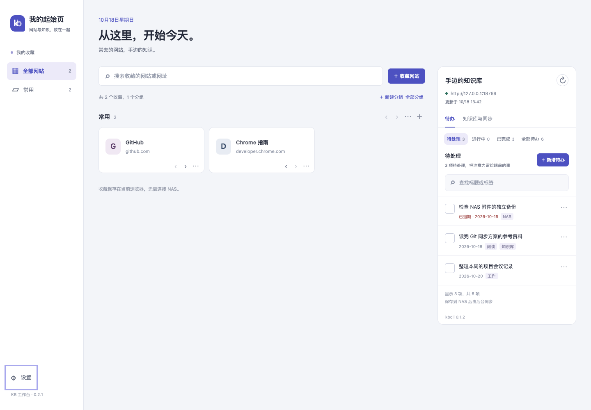

# Chrome 插件技能审查（0.2.1）

2026-10-18 对 `extensions/chrome-kb` 的实现、测试和发布包进行检查并修复。本轮使用项目内 [chrome-extensions](../.agents/skills/chrome-extensions/SKILL.md) 与 [modern-web-guidance](../.agents/skills/modern-web-guidance/SKILL.md)，在线检索并读取 `accessibility`、`accessible-error-announcement` 两份指南。

## 主要发现及处理

| 优先级 | 原问题与触发条件 | 已完成的处理 |
| --- | --- | --- |
| P1 | 待办表单打开后，另一标签页切换 NAS；提交使用当时最新连接，草稿可能发往错误目标 | 表单绑定打开时的连接 revision，连接变更立即清空展示缓存、禁用旧表单并保留草稿；后台要求写入、连接修改和断开都匹配原连接版本 |
| P2 | 后台所有写操作共用队列；NAS 写入及后续刷新慢时，本地收藏请求也等待 | 收藏与 NAS 使用独立队列；本地写入在控制器内部串行，真实后台入口测试验证慢 NAS 不阻塞收藏 |
| P2 | 快照刷新绕过写入队列；较早发出的读取可能较晚覆盖保存后的缓存 | NAS 读写统一排序，同时发起的快照请求合并；缓存提交和写入后的刷新处于同一队列 |
| P2 | `{ok:true,tasks:"broken"}` 被当作可写数据，或 JSON null 被误报为断网 | 校验任务数组、必要字段和身份；坏数据保留旧缓存并禁写。写入回执缺少保存哈希时保持“结果不确定”，不重放 |
| P2 | 收藏导出没有 2 MB 上限，导入却限制 2 MB；中文字符的字符串长度也不等于文件字节数 | 导入按 UTF-8 字节限制为 16 MiB，足以覆盖现有 100 分组/2000 网站约束下的导出；测试超过旧上限的备份可完整导入。导出明确挑选字段 |
| P2 | 发送页面按 URL 前缀匹配；存储访问限制初始化失败未捕获 | 校验完整页面路径，仅允许 newtab.html（可带 query/hash）；同步注册事件，在处理前等待初始化，失败返回固定错误 |
| P2 | 筛选、排序、自动刷新重建 DOM 后丢失键盘焦点；编辑后原按钮已脱离 DOM | 用稳定键恢复焦点；排序到边界时转至同一卡片链接；原生 dialog 关闭后回到原按钮或合适的备用入口 |
| P3 | 字段错误仅有一段提示，与具体输入框缺少关联；待办弹窗无可访问名称 | 原生表单约束结合 `:user-invalid`、`aria-invalid` 与 `aria-errormessage`；错误定位输入框，补显式标签和弹窗名称 |
| P3 | 每张卡片重新过滤整份收藏并查找位置；大分组重复遍历 | 每次渲染预先按组建立列表和位置索引，减少组内重复遍历 |
| P3 | HTTP 状态在后台错误消息中丢失，404 升级提示无法正确命中 | 错误消息保留受限的 HTTP 状态和字段标识，继续不显示后台原始调试内容 |

另外补充了跳到收藏/知识库的键盘入口、原生列表语义和触控目标尺寸；移除整份动态列表的 live region，保存反馈保留在现有状态提示中。Escape、关闭按钮及程序关闭时同步清除输入框中的令牌，并保留原生 close 事件作为补充，连接验证期间锁定本次提交参数。

## 已核对并保留的设计

- Manifest V3，最低 Chrome 120；页面脚本全部本地打包，没有 eval、远程脚本或内联事件。
- 安装权限仍只有 storage；NAS 按用户手势申请指定主机的权限。没有为打开新标签页增添 tabs 权限，也没有把页面内知识库栏误当成 Chrome Side Panel API。
- 凭据不写入仓库、扩展包或收藏备份；host permission 按主机匹配，无法按端口隔离，实际 API 请求固定到配置中的地址和路径。
- 收藏、配置、缓存均持久化到 storage。后台内存中的队列只协调当前请求，不承担用户数据持久化；无需为此增加后台保活或 alarms 权限。
- 页面可见时的 30 秒刷新属于新标签页生命周期，NAS 的 Git 自动同步继续由已有 NAS 服务负责。
- 保留文件哈希冲突保护、失败写入不重放、离线缓存只读，以及用户完成待办无需再次人工审核的行为。
- 未创建 Chrome Web Store 发布材料：本轮是私有扩展实现审查，没有商店发布请求。

## 验证

- `node --test tests/extension/*.test.mjs`：30 项通过，包括直接加载后台模块并模拟 Chrome 消息入口、存储初始化失败、慢 NAS、本地并发、刷新合并、旧连接写入、异常回执和大备份。
- 其中包括 3 项令牌清理事件级回归：取消立即清空、连接保存中阻止取消、程序关闭时先清空再关闭。
- `pytest -q tests/test_extension_api.py tests/test_extension_package.py`：4 项通过。另有已有依赖的 Starlette TestClient 弃用提示，本轮未修改该依赖。
- 隔离浏览器连接真实隔离 kbcli API，通过测试专用 Chrome shim 验证：收藏新增/编辑/排序、网址错误与 ARIA 状态、筛选后焦点、编辑后焦点返回、多标签页重连后旧待办草稿禁写、待办新增/日期清除/完成、页签 Home/End，以及 390px 无横向溢出。未使用正式 NAS 令牌或修改正式知识内容。
- 构建安装包继续采用白名单，包含新增的 ui.mjs；开发技能、测试 shim 与凭据不进入扩展包。
- 提交收尾复验：Ruff 通过，完整 Python 测试 76 项通过，Node 测试 30 项通过；安装包文件白名单、哈希和源码一致性已核对。

## 验收边界

自动化页面测试使用 Chrome API shim，后台入口测试使用受控的 Chrome API 替身；它们不等同于原生扩展安装。当前浏览器工具不能直接加载未打包扩展，仍需在真实 Chrome 验证安装、首次主机授权、本地网络访问提示及浏览器终止/恢复 worker。实际屏幕阅读器验收和完整视觉对比度审计也尚未进行，不宣称满足完整无障碍合规标准。

本地 storage 并非加密凭据库，同一扩展的受信任页面可访问其本地数据；本轮限制的是展示快照、备份及打包边界，没有新增硬件凭据保护。
