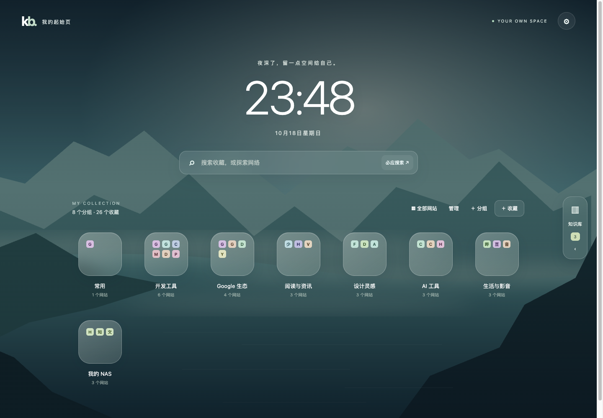
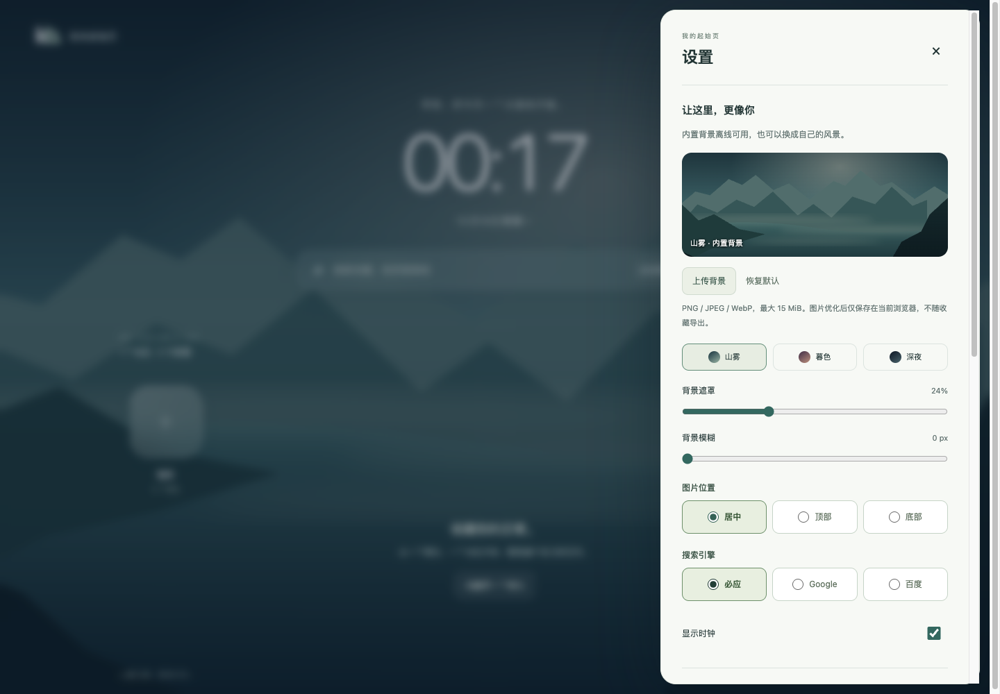
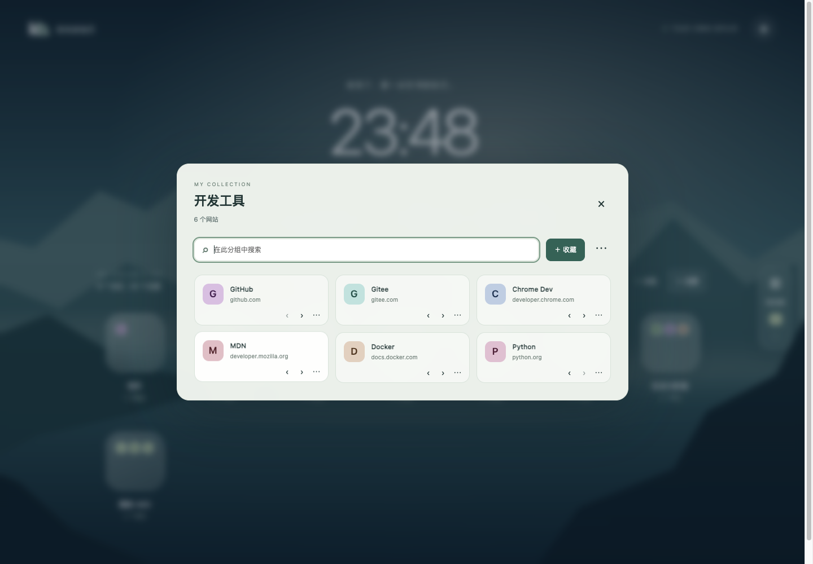
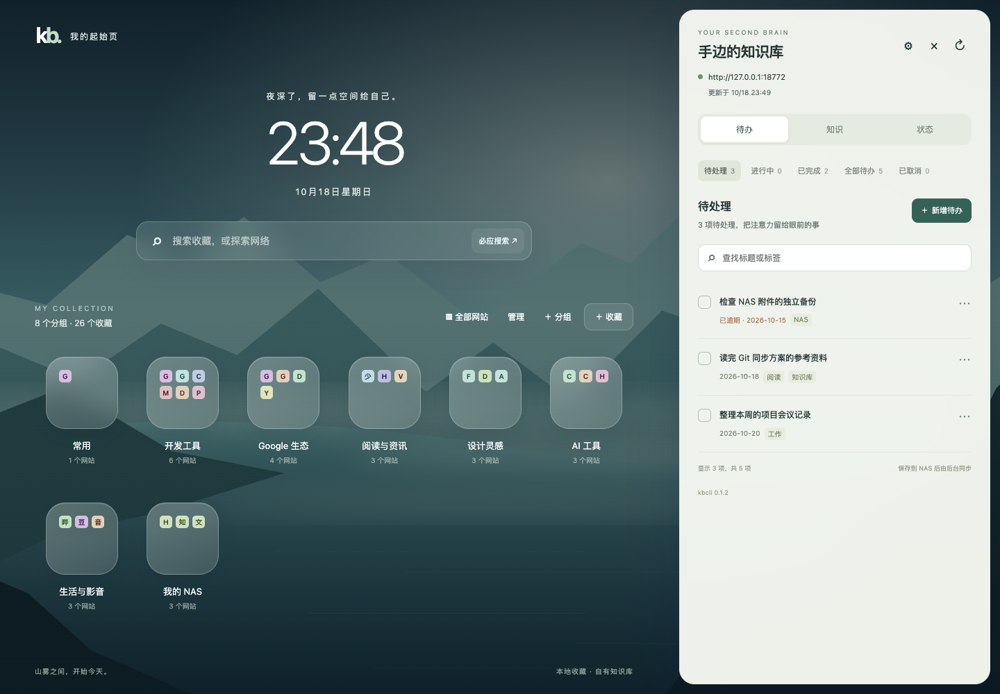

# Chrome 新标签页插件

当前界面版本为 0.15.0。采用文件夹主页、固定底部状态栏、居中六类完整设置与知识面板；使用本地打包的 Motion 轻盈弹簧。待办固定筛选和搜索，文章增加目录与字号偏好。原有业务模块和数据契约保留，新增的本机显示偏好独立存储。

代码位于 extensions/chrome-kb，扩展版本 0.15.0，含图标完整备份与共享同步需 kbcli 0.1.5+。安装、连接与使用步骤见 [扩展 README](../extensions/chrome-kb/README.md)。

截图中的收藏与待办均为隔离测试示例；不包含真实知识内容或凭据。

## 页面与数据归属

主页以离线山雾背景、时钟与搜索、磨砂分组文件夹为主，点击文件夹展开网站；可切换全部网站视图。“管理”展示分组排序入口。知识库默认收起，右侧按需展开“待办 / 知识 / 状态”；桌面与窄屏均使用原生模态 dialog 悬浮展示，背景主页布局保持不动；外部点击仅关闭最上层，焦点返回原入口。设置抽屉支持本地背景上传、遮罩、模糊、位置、色调、时钟、搜索引擎、收藏备份与 NAS 连接。设计参考与取舍见 [设计说明](chrome-newtab-design.md)。

收藏、分组、排序和偏好沿用本机 navigation v1；背景及外观独立存为 appearance，不改变旧数据，不进入收藏备份；待办仍通过 NAS 的 kbcli 修改 Markdown 并由原自动同步调度器处理。插件通过专用接口自动备份收藏、分组和设置到知识库，并由既有 Git 同步推送；NAS 不可用不影响本机收藏，恢复连接后补传。详见[备份与恢复](chrome-backups.md)。默认不读取原生 Chrome 书签，也不请求 bookmarks 权限。

收藏支持新增、修改、删除、跨分组移动及组内排序；分组支持新增、改名、排序及删除。删除分组将网站迁入默认分组，默认分组可改名、排序，不能删除。收藏备份使用独立 JSON 格式，导入合并、同组网址去重，校验失败整批不保存。多个标签页的本地写入由 service worker 排队并核对 revision，旧表单不会直接覆盖新版本。

## 结构与权限

- newtab.html、style.css、app.mjs：中文新标签页、待办表单、筛选、错误和缓存状态。
- navigation.mjs、navigation-ui.mjs：收藏数据校验、版本保护、分组与网站操作、显示偏好及备份导入导出。
- appearance.mjs、appearance-ui.mjs、assets/mist.svg：外观版本校验、图片格式及体积限制、浏览器重编码与本地默认背景。
- shell.mjs、knowledge-ui.mjs：响应式知识抽屉、最近文档、搜索和居中只读 Markdown 阅读；连接变化时关闭文章并丢弃旧请求结果。
- backup.mjs、backup-ui.mjs：按设备持久 outbox、离线补传、备份设置、历史预览、确认恢复及本机撤销。
- background.mjs：扩展 service worker，同步注册消息入口，核对发送页面，等待存储访问限制初始化。
- controller.mjs：独立的收藏与 NAS 请求队列，NAS 快照合并及缓存写入排序；队列只协调当前请求，用户状态持久化到 storage。
- controls.mjs：自定义开关/分段视觉、下拉菜单、日期浮层、键盘导航、焦点和动态选项同步。
- ui.mjs：列表重绘和弹窗关闭后的焦点恢复、字段错误状态与原生表单校验。
- api.mjs、controller.mjs：固定路径请求、字段验证、文件哈希、缓存、身份与连接版本保护，可在 Node 中独立测试。
- scripts/build_extension.py：仅打包显式白名单文件，同时生成资源哈希清单。

扩展申请 storage、alarms 与运行时按需的 NAS 主机权限；alarms 用于浏览器运行期间检查待传备份。用户令牌留在后台的本机配置中，业务消息快照仅返回公开连接信息、数据与错误；本地存储限 trusted contexts，不使用账号同步；这不是加密密码库，同一扩展的受信任页面仍可访问其本地存储。无任意 URL 代理、远程脚本、eval、原文 HTML 执行或生产 mock。标题、标签及错误通过 textContent 写入 DOM。

页面以用户直接完成待办为设计前提，连接时通过 GET /api/status 的 role 验证 human。提交完成只发送 status=done 与预期哈希，避免混入内容修改。普通编辑沿用既有复核规则，agent 身份限制仍由服务端执行。

## 后端补充

- `/api/status` 新增 role，沿用原 Bearer 认证。
- 新增 `/api/autosync`，只读观察库外 status.json 和 pause.json；KBCLI_AUTOSYNC_STATE_DIR 显式指定目录。不创建目录、恢复操作或解除暂停。
- 只返回状态、频率、时间和标准错误信息，不返回原始日志、路径、凭据或错误详情。240 秒无有效心跳时标为 stale；独立暂停标记优先，重启不抹除。
- 日期传 null 可清除待办截止日期；重新打开任务时清除旧 completed_at。

未安装调度器、未配置状态目录、文件不可读、暂停与离线均为不同结果。该接口不新增暂停/恢复操作，也不把 Git 对齐与索引更新混为一谈。

## 验证记录（2026-10-18）

- 0.2.0 新增收藏离线可用、worker 重启持久化、断开 NAS 保留收藏、危险 URL 拦截、分组删除保留网站、组内排序与跨组移动、多标签页版本冲突、错误输入不覆盖及原子备份合并测试。
- 0.2.0 浏览器验证收藏新增、编辑、跨组移动、排序、搜索、删除、删除分组保留网站，设置开关与持久化，备份导出再导入去重，多标签页冲突保留草稿，危险标题按纯文本展示；右侧待办新增与完成正常。离线时收藏仍可新增和删除，NAS 待办缓存只读，恢复网络可继续操作。
- 前端 15 项测试、Python 76 项测试通过；其中 5 项依赖 uv 缓存的发布/安装测试在允许读取缓存后通过。

- Node 测试覆盖 URL、用户身份、主机权限、令牌边界、缓存只读、写入不重放、版本冲突与连接切换。
- Python 测试覆盖新接口认证、只读与脱敏、缺失/损坏/过期状态、日期清除、重新打开、完成保持复核状态及旧哈希拒绝。
- 浏览器使用真实隔离 kbcli 接口与仅用于测试的 Chrome API shim，验证新增、修改、日期清除、完成、并发冲突草稿保留、暂停提示、离线缓存禁写和恢复。390px 视口无横向溢出。
- NAS 服务已在库外独立环境升级到 0.1.2；同一插件客户端代码用现有用户身份进行只读实机联调，读取 5 条知识记录、1 条待办和 idle 调度状态。原服务与调度器健康，知识库 Git 工作区干净。
- 当前自动化浏览器不提供加载 Chrome 扩展的调试能力，实际 MV3 安装、主机权限弹窗及特定 Chrome 版本的局域网访问仍需用户加载后验证。页面测试不替代这些验收项。

正式 NAS 上未新增或修改测试待办；写入测试都在独立测试库中完成。

## 0.2.1 技能审查

本轮使用项目内的 chrome-extensions 与 modern-web-guidance，详见 [审查结果](chrome-extension-audit.md)。本轮仅修复插件与测试、更新文档，不修改 NAS 服务和正式知识内容。

## 0.3.x 新标签页改版

背景文件经过浏览器重新编码后存入本机 appearance，最长边 2560px、保存值最大 2 MiB，避免占满 storage.local。原图限 15 MiB / 4000 万像素；解码、校验和存储失败均不替换旧背景。图片不进入 NAS、收藏备份或发布包。跨标签页变更有独立 revision，上传期间发生外部修改会拒绝旧版本保存。

本轮交互、兼容边界和测试结果见 [新版验收记录](verification/chrome-newtab-0.3.0.md)。Chrome 最低版本仍为 120，无新增权限、远程脚本、第三方图标或统计请求。检索和预览复用 kbcli 0.1.2 已有只读接口，无需 NAS 升级。

0.3.1 统一弹窗外部点击关闭，知识库与设置抽屉悬浮覆盖主页，不挤压收藏网格。原生 closedby 不可用时有 Chrome 120 兼容层，继续遵守保存/连接保护并清空设置令牌输入。详见 [悬浮与关闭验收](verification/chrome-dialogs-0.3.1.md)。

## 0.4.0 抽屉细节与 Markdown 阅读

统一三个页签的控件、文本层级和间距，修复知识搜索框与普通表单字段样式叠加产生的双重边框及高度错位。顶部连接与页签固定，内容独立滚动；切换页签保留各自滚动位置。

文章从抽屉内纯文本切换为居中的只读弹窗；标题、列表、引用、表格和代码块由本地 markdown-it 15.0.3 解析后，以白名单 DOM 节点创建，不经过 innerHTML，不启用原文 HTML。相对 .md 链接继续读取库内文件，外链仅允许 HTTP/HTTPS；图片按链接或附件提示展示。解析器来源、哈希与许可证见 [vendor 说明](../extensions/chrome-kb/vendor/README.md)。

三页签截图、问题分析、验证范围见 [0.4.0 验收记录](verification/chrome-reader-0.4.0.md)。

## 0.4.1 设置真实点击修复

图片位置和搜索引擎的三选一设置改为直接可见的原生单选组，避开原生下拉菜单交互；保存完成后保留键盘焦点。修正收藏偏好保存时误操作时钟开关的控件范围。

本轮逐项使用真实鼠标点击、滑轨和文件选择器验证设置，不使用 selectOption 或模拟 change。详见 [设置验收记录](verification/chrome-settings-0.4.1.md)。

## 当前版本整理

本次源码整理覆盖 0.3.0–0.4.1，当前安装版本为 0.4.1。汇总见 [提交验收](verification/chrome-0.4.1-release.md)，复现命令与浏览器场景说明见 [测试入口](../tests/extension/README.md)。dist 产物不提交 Git，本次不创建版本 tag 或 GitHub Release。

## 0.5.1 控件视觉统一

设置使用自定义滑动开关、分段按钮和进度滑轨，表单统一圆角、边框、焦点与禁用状态。网站分组、待办状态、日期选择以自定义 DOM 浮层呈现，避免系统下拉和日历样式。底层表单值和校验协议不变，无新增权限或依赖，NAS API 不需要升级。验收见[自定义控件](verification/chrome-controls-0.5.1.md)。

## 0.6.0 多设备同步

配置、收藏和分组通过 NAS 共享版本自动更新，完整能力需要 kbcli 0.1.4。默认启用、离线补传、版本比较、冲突保护和明确处理见[共享同步](chrome-workspace-sync.md)。原设备备份保留，不使用 Chrome 账号同步或本机 Git 凭据。[本次验收](verification/chrome-workspace-0.6.0.md)。

## 0.6.1 项目图标

按用户参考图生成统一 kb. 图标，用于扩展管理、工具栏、页签与首页品牌。PNG/ICO 母版、尺寸导出及提示词见[品牌资源](../assets/branding/README.md)。

## 0.7.0 网站图标、紧凑网格与拖动

通过 Chrome favicon 权限获取网站来源的图标，失败时回退首字；不新增全网主机授权、第三方图标服务或图标同步字段。网站改为上图下文的紧凑网格。SortableJS 1.15.7 ESM 随包固定发布，包含自动滚动；拖动仅从可聚焦手柄启动，提供方向键与原移动按钮作为替代。

新增 group.place / bookmark.place 原子操作，以目标分组和后继网站 ID 定位，沿用 revision 与 worker 串行写入；跨组与排序均由既有 NAS 备份/共享同步处理，无需 NAS 升级。搜索期间禁排，拖动期间延后外部重绘，版本冲突拒绝保存并恢复最新数据。

图标优先使用 Chrome 缓存；遇到默认地球图标或缓存不可用时，尝试网站自身来源下的 /favicon.ico，失败回退首字。图片请求使用 no-referrer，不包含收藏原网址中的路径、查询参数与片段，不接第三方聚合图标服务。网站图标仍由浏览器缓存，不进入 NAS 备份或共享数据。

验收范围与实机更新记录见[0.7.0 验收](verification/chrome-navigation-0.7.0.md)。

## 0.7.1 固定布局与独立滚动

以动态视口高度分配顶部、中间与底部空间；中间列表使用可收缩的 flex 区域与独立滚动容器，稳定滚动条槽位并限制滚动链。分组弹窗同样拆分固定工具栏与滚动内容，沿用拖动自动滚动。无新权限、依赖、存储字段或 NAS 变更。[验收记录](verification/chrome-scroll-0.7.1.md)。

## 0.7.2 图标复用与弹窗稳定性

移除文件夹打开时的主页全量重建，按 revision / 分组 / 搜索 / 整理状态保留已有弹窗内容。重复的相同 revision 存储通知不重绘。favicon 模块按来源合并并发加载、保留成功/失败位图结果，预览与完整图标共用；缓存命中同步绘制，首次加载以 IntersectionObserver 按需触发。缓存只活在当前页面，手动刷新重新检查，不新增存储或 NAS 字段。

分组弹窗取消顶层缩放和延迟退出，移除叠加 backdrop-filter，使用稳定表面；其他编辑/设置弹窗继续沿用原交互。[验收记录](verification/chrome-cache-0.7.2.md)。

## 0.7.3 鼠标移走收起手柄

将卡片控件的 focus-within 改为 :has(:focus-visible)，区分鼠标点击留下的焦点与键盘操作；隐藏手柄 pointer-events:none，显示时恢复。管理与触屏行为保留。Ego 验证：悬停 opacity=1；关闭分组并移出后，焦点仍在分组但 focus-visible=false、手柄 opacity=0/pointer-events=none；按 Tab 到手柄后 opacity=1，管理模式移出仍 opacity=1。

## 0.8.0 持久图标缓存（历史，0.11.0 已替换）

favicon-store.mjs 通过后台 fetch 图片路由提供 Cache Storage 缓存。虚拟 HTTPS key 仅作为存储标识，绝不请求该域名。来源必须已存在于收藏，只请求 favicon 固定路径；跨域响应以 opaque 形式保存，权限不扩展。图片在前台解码验证后才提交索引，候选响应先写入不可变条目，更新索引失败不会破坏旧版本；按请求时间拒绝较旧结果，失败刷新保留旧图标。

新页读取持久缓存；Reload 与设置中的手动更新才重新检查。已解码位图仍只放本页内存。最多四个来源并发，手动批量更新完成前保持旧显示。独立缓存不参与 NAS 备份或共享，不触发收藏 revision 与同步。[验收与剩余实机项](verification/chrome-favicon-cache-0.8.0.md)。

## 0.8.1 整卡直接拖动

取消 SortableJS handle 限制，过滤卡片内编辑和排序控件并保留其点击行为。桌面 8px 位移阈值；触屏 250ms 长按与 6px 延迟取消阈值，短滑仍滚动。手柄仅作键盘/管理辅助入口。[验收记录](verification/chrome-direct-drag-0.8.1.md)。

## 0.8.2 直接跨组与拖动预览

默认展示固定横向跨组栏，图标网格继续独立滚动。浮动预览移到当前 dialog 顶层子节点（主页则移到 body），禁用预览 transform transition，保留邻居让位动画；Canvas 像素沿用复制逻辑。按指针与目标栏实际几何位置计算高亮和松手目标，处理自动横向滚动造成的目标变化，落在栏外或间隙则不保留过时的投放目标。[验收记录](verification/chrome-drop-feedback-0.8.2.md)。

## 0.9.0 拖出窗口投放首页文件夹

普通分组视图收起横向目标栏。网站拖过窗口边缘后显示真实首页文件夹，以几何命中识别投放目标；弹窗保持打开以保留拖动顶层和取消状态。支持目标高亮、名称提示、中间区域自动边缘滚动和滚轮滚动；空白、原分组、Esc 或指针取消均不写入。成功后关闭分组留在首页，继续使用 revision 校验的 bookmark.place。[验收记录](verification/chrome-home-folder-drop-0.9.0.md)。

## 0.9.1 悬停展开后按位置投放

首页文件夹连续悬停 650ms 后，在原 modal 内展示独立目标网格，保留源 Sortable 节点与浮动预览。命中按网格行和卡片左右半区计算 beforeId；绝对定位插入线不影响布局，滚动后和松手时重算。仅松手调用原 revision 校验 bookmark.place，悬停切组不会写存储。目标视图支持边缘与滚轮滚动，离开窗口返回首页，取消恢复源分组。Sortable 本地补丁在新 pointerdown 清理遗留点击抑制，防止吞掉后续独立点击。[验收记录](verification/chrome-spring-folders-0.9.1.md)。

## 0.10.0 工具栏快捷收藏

默认 action popup 取代打开新标签页的 action.onClicked，400px 原生弹窗带预填、分组搜索/新增、三种图标来源、逐次草稿保存、重复网址编辑与 revision 冲突保护。popup 精确加入后台发送者白名单，只允许快捷收藏消息和分组新增，不能调用 NAS 凭据或任务写入接口。activeTab + scripting 仅在工具栏点击后读取顶层标题/图标元信息。

图标按 bookmark.icon 可选字段持久化：text 或规范化为 WebP 的 auto/image，不依赖远程图片重载；旧记录无 icon 继续沿用原 favicon 缓存。cleanPayload/exportNavigation 保留已校验的图标，NAS 0.1.5 的备份/共享校验兼容旧记录并支持新字段。草稿及临时操作信息不进入导出或 NAS 备份。[验收记录](verification/chrome-capture-0.10.0.md)。

## 0.10.1 保存后自动关闭、工作台原地编辑

工具栏在 capture.save 成功响应后调用 window.close，失败保持输入。工作台使用原生 dialog 承载同源 popup 编辑器；编辑器通过来源窗口、精确 origin 和每次打开随机 channel 校验的消息通知父页面关闭，不对工作台调用 window.close，也不创建新标签页。带入基础表单改动，成功后刷新卡片并恢复焦点；草稿仍使用原上下文保存。保存时关闭保护、子分组下拉优先关闭、取消和移除 iframe 的清理均沿用原生 dialog 生命周期。无新增权限、后端数据字段或 NAS 升级要求。[验收记录](verification/chrome-capture-close-0.10.1.md)。

## 0.11.0 创建时固定图标

移除页面刷新判定、按来源自动补图、IntersectionObserver 图标获取链和旧后台 favicon fetch 路由；当前网格、分组预览与拖动预览直接呈现单条收藏的内嵌 WebP / 文字快照。旧自动加载模块不再进入发布白名单。只在创建表单或手动图标编辑中调用 capture.image；创建失败保存文字，之后不重试，普通编辑不更换图标。

后台 freezeIcons 在本地请求队列内升级缺少图标的旧收藏。icon-snapshots.mjs 读取可解码的既有 Cache Storage 响应，受容量上限与 revision 校验保护；opaque、缺失、损坏或不可访问的缓存直接使用固定文字，不 fetch 来源、不覆盖已有自定义图标。升级后 worker 重建、缓存丢失和页面 reload 均不重新获取来源。[验收记录](verification/chrome-frozen-icons-0.11.0.md)。

### 手动检查网站（0.12.0）

首页“检查网站”可手动检查全部收藏，汇总异常、显示最近状态，并在选择和确认后批量删除，支持本机撤销。不会在打开新标签页时自动检查。详细范围、权限和误报说明见 [扩展说明](../extensions/chrome-kb/README.md#手动网站可用性检查0120)。

### 批量获取网站图标（0.13.0）

首页“获取图标”或设置的收藏数据中，可手动一键尝试所有网站图标，查看进度和失败原因；默认保留自定义图标，用户可勾选替换。失败保留原图标，结果持久保存，打开新标签页不会自动重试。

### 0.15.0 界面模块

- workbench-ui.mjs / workbench.css：完整设置分类、底部信息栏、知识工作区和阅读目录；复用原 DOM 字段及业务事件。
- motion-ui.mjs：统一进入、关闭、中断、焦点与顶层窗口协调；保留忙碌保护、令牌清除、内外拖选和控件先关闭规则。
- vendor/motion-14.6.0.mjs：Motion 及同版本依赖的本地 ESM 打包；MIT 许可随包发布。无远程脚本或新增权限。
- workbenchInterface：新增独立本机偏好（深浅配色、减少动画、阅读字号）；现有 navigation / appearance / connection / workspace / backup 及图标数据不变。

### 当前待办与阅读效果（隔离测试数据）

