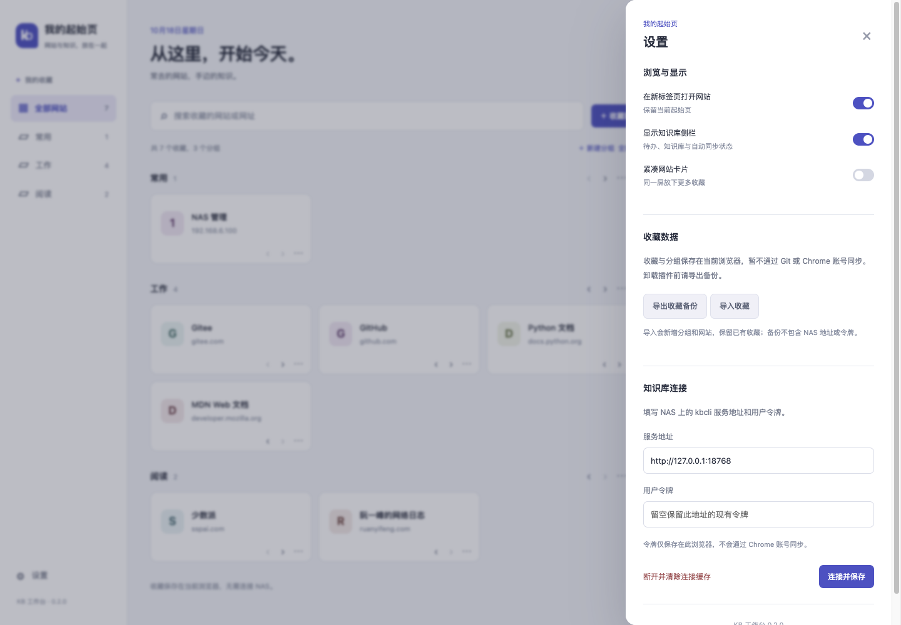

# Chrome 新标签页插件

代码位于 extensions/chrome-kb，扩展版本 0.2.1，配套服务接口为 kbcli 0.1.2。安装、连接与使用步骤见 [扩展 README](../extensions/chrome-kb/README.md)。

截图中的收藏与待办均为隔离测试示例；不包含真实知识内容或凭据。

## 页面与数据归属

左侧为网站分组，主区域为收藏搜索及网站卡片，右侧为知识库侧栏，分为“待办”和“知识库与同步”两个页签。设置采用右侧抽屉，可调整打开方式、显示侧栏和卡片密度，管理收藏备份并配置 NAS。

收藏、分组、排序和偏好存为本机独立 navigation 数据；待办仍通过 NAS 的 kbcli 修改 Markdown 并由原自动同步调度器处理。插件收藏当前不参与 Git 同步，NAS 不可用不影响收藏。默认不读取原生 Chrome 书签，也不请求 bookmarks 权限。

收藏支持新增、修改、删除、跨分组移动及组内排序；分组支持新增、改名、排序及删除。删除分组将网站迁入默认分组，默认分组可改名、排序，不能删除。收藏备份使用独立 JSON 格式，导入合并、同组网址去重，校验失败整批不保存。多个标签页的本地写入由 service worker 排队并核对 revision，旧表单不会直接覆盖新版本。

## 结构与权限

- newtab.html、style.css、app.mjs：中文新标签页、待办表单、筛选、错误和缓存状态。
- navigation.mjs、navigation-ui.mjs：收藏数据校验、版本保护、分组与网站操作、显示偏好及备份导入导出。
- background.mjs：扩展 service worker，同步注册消息入口，核对发送页面，等待存储访问限制初始化。
- controller.mjs：独立的收藏与 NAS 请求队列，NAS 快照合并及缓存写入排序；队列只协调当前请求，用户状态持久化到 storage。
- ui.mjs：列表重绘和弹窗关闭后的焦点恢复、字段错误状态与原生表单校验。
- api.mjs、controller.mjs：固定路径请求、字段验证、文件哈希、缓存、身份与连接版本保护，可在 Node 中独立测试。
- scripts/build_extension.py：仅打包显式白名单文件，同时生成资源哈希清单。

扩展仅申请 storage 与运行时按需的 NAS 主机权限。用户令牌留在后台的本机配置中，业务消息快照仅返回公开连接信息、数据与错误；本地存储限 trusted contexts，不使用账号同步；这不是加密密码库，同一扩展的受信任页面仍可访问其本地存储。无任意 URL 代理、远程脚本、eval、HTML 知识渲染或生产 mock。标题、标签及错误通过 textContent 写入 DOM。

页面以用户直接完成待办为设计前提，连接时通过 GET /api/status 的 role 验证 human。提交完成只发送 status=done 与预期哈希，避免混入内容修改。普通编辑沿用既有复核规则，agent 身份限制仍由服务端执行。

## 后端补充

- `/api/status` 新增 role，沿用原 Bearer 认证。
- 新增 `/api/autosync`，只读观察库外 status.json 和 pause.json；KBCLI_AUTOSYNC_STATE_DIR 显式指定目录。不创建目录、恢复操作或解除暂停。
- 只返回状态、频率、时间和标准错误信息，不返回原始日志、路径、凭据或错误详情。240 秒无有效心跳时标为 stale；独立暂停标记优先，重启不抹除。
- 日期传 null 可清除待办截止日期；重新打开任务时清除旧 completed_at。

未安装调度器、未配置状态目录、文件不可读、暂停与离线均为不同结果。该接口不新增暂停/恢复操作，也不把 Git 对齐与索引更新混为一谈。

## 验证记录（2026-10-18）

- 0.2.0 新增收藏离线可用、worker 重启持久化、断开 NAS 保留收藏、危险 URL 拦截、分组删除保留网站、组内排序与跨组移动、多标签页版本冲突、错误输入不覆盖及原子备份合并测试。
- 0.2.0 浏览器验证收藏新增、编辑、跨组移动、排序、搜索、删除、删除分组保留网站，设置开关与持久化，备份导出再导入去重，多标签页冲突保留草稿，危险标题按纯文本展示；右侧待办新增与完成正常。离线时收藏仍可新增和删除，NAS 待办缓存只读，恢复网络可继续操作。
- 前端 15 项测试、Python 76 项测试通过；其中 5 项依赖 uv 缓存的发布/安装测试在允许读取缓存后通过。

- Node 测试覆盖 URL、用户身份、主机权限、令牌边界、缓存只读、写入不重放、版本冲突与连接切换。
- Python 测试覆盖新接口认证、只读与脱敏、缺失/损坏/过期状态、日期清除、重新打开、完成保持复核状态及旧哈希拒绝。
- 浏览器使用真实隔离 kbcli 接口与仅用于测试的 Chrome API shim，验证新增、修改、日期清除、完成、并发冲突草稿保留、暂停提示、离线缓存禁写和恢复。390px 视口无横向溢出。
- NAS 服务已在库外独立环境升级到 0.1.2；同一插件客户端代码用现有用户身份进行只读实机联调，读取 5 条知识记录、1 条待办和 idle 调度状态。原服务与调度器健康，知识库 Git 工作区干净。
- 当前自动化浏览器不提供加载 Chrome 扩展的调试能力，实际 MV3 安装、主机权限弹窗及特定 Chrome 版本的局域网访问仍需用户加载后验证。页面测试不替代这些验收项。

正式 NAS 上未新增或修改测试待办；写入测试都在独立测试库中完成。

## 0.2.1 技能审查

本轮使用项目内的 chrome-extensions 与 modern-web-guidance，详见 [审查结果](chrome-extension-audit.md)。本轮仅修复插件与测试、更新文档，不修改 NAS 服务和正式知识内容。
