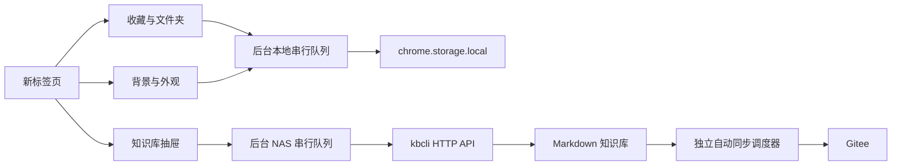

# 新标签页 0.3.x–0.4.x 设计

以用户提供的“壁纸 + 分组文件夹”截图为布局依据，保留自由桌面感；知识库提供随手可用的工具抽屉，默认收起。

## 参考与取舍

2026-10-18 查阅项目官方页面：[Bonjourr](https://bonjourr.fr/) 的轻量时钟、搜索与快捷链接；[Tabliss](https://tabliss.io/) 的背景及组件个性化；[nightTab](https://github.com/zombieFox/nightTab) 的收藏布局与分组思路。仅参考产品交互，不复制代码或视觉素材。

- 主页用深青色山雾插画、系统字体、大时钟、较宽的收藏间距。默认背景由项目绘制为 SVG，离线可靠，无壁纸网络依赖。
- 半透明文件夹展示最多 9 个小图标，名称与数量放在下方；点击后原生 dialog 展开该组网站。图标以网站名称首字本地生成，不向第三方查询用户收藏。
- 主页搜索同时筛选收藏，明确点击搜索引擎按钮或按 Enter 才搜索网页。文件夹独立组内搜索，检索知识在知识页签操作，避免混淆目标。
- 0.3.1 起知识与设置抽屉统一为原生模态悬浮层，展开前后主页、时钟和分组位置及宽度保持一致；响应式 CSS 调整抽屉自身尺寸，不改变主页布局。点击外部遮罩收起，键盘焦点由原生 dialog 约束。
- 待办完成保持用户操作直接生效，不增加内容审核。0.4.0 起知识阅读使用居中只读弹窗，本地 Markdown 解析器只产出白名单 DOM 节点；原文 HTML 作为文字显示。
- 设置覆盖外观、显示、收藏备份及连接。背景仅存浏览器，不上传 NAS；收藏导出保持原格式，不夹带壁纸或凭据。
- 动效只用于文件夹悬停、弹窗和抽屉开关；尊重减少动态效果设置。现代顶层过渡为渐进增强，原生 dialog 负责交互，关闭不依赖动画计时器。所有弹窗使用 closedby="any"；Chrome 120–133 的兼容层复用 cancel 事件，保留保存期间的关闭保护和令牌清理，从内部开始拖动不当作外部点击。

## 模块与状态

navigation schema 继续为 v1；appearance 使用自己的 revision，修改只白名单合并该键。connection 与 NAS 快照保持原样。知识列表和渲染正文只存在页面内存，不新增离线全文缓存；连接变更立即清除，旧请求响应不再呈现。

## 明确边界

不读取浏览器原生书签、不同步背景和收藏到 NAS；不加入后台壁纸下载、拖拽排序、富文本知识编辑或新的 Git 控制入口。现有箭头排序与编辑移动分组继续可用。设置更换 NAS 的身份及版本保护继续保留。
