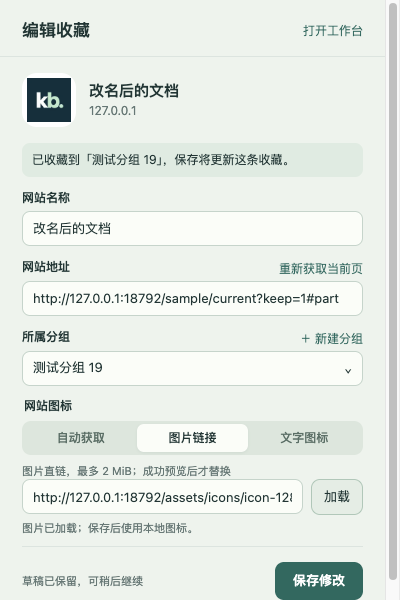

# 快速收藏弹窗验收（Chrome 0.10.0 / kbcli 0.1.5）

日期：2026-10-20。

## 实现与兼容性

- action.default_popup=popup.html，移除原 action.onClicked 新开首页行为；弹窗与首页图标编辑入口共用同一表单。
- activeTab + scripting 在工具栏点击后的当前顶层网页提取标题、网址、link 图标元信息。受限页面保留手动表单。
- popup 精确白名单，仅允许 capture.load/draft/save/image、navigation.get、group.add，不可访问 NAS 凭据或任务写入接口。
- capture 草稿即时交给后台串行保存，最多 10 个页面上下文，7 天内可恢复；不进入备份。稳定创建 ID 与保存内容比较支持响应丢失后的无害重试，版本检查保护不同内容的并发修改。
- icon 是单条收藏的可选字段，支持 text、auto/image WebP。图片输入限 2 MiB，规范化为 128px、最大 32 KiB WebP，总图标不超过 1 MiB。图片链接按点击申请主机权限，不携带 cookie/referrer，不跟随跳转。图片失败、未完成或拒绝权限时保存仍可使用当前图标。
- 旧编辑表单未传 icon 时保留图标。导出/导入、备份恢复、共享 payload 保留图标；NAS 校验增加兼容的可选字段，版本 0.1.5。未自动部署 NAS；旧 NAS 需要升级，各同步设备应使用 0.10.0。

## 自动与页面验收

Ego TaskSpace 17，loopback fixture 18792；合成网页、26 个分组和测试收藏，非真实浏览器收藏数据。可复现脚本 tests/extension/verify_capture.mjs。

- 当前页自动预填完整路径、查询和片段；默认上次成功分组。
- 搜索 26 个分组、选择第 19 个、新建分组并保存。
- 修改标题、分组、文字图标后重载，草稿恢复；已收藏网址进入编辑，保存保持原 ID，数量不增加。
- 图片 URL 真实 loopback 请求、WebP 预览、保存，首页文件夹显示相同内嵌图标与标题。
- 错误图片和拒绝授权均保留旧图片；无效图片输入不阻止保存网站。
- 从首页编辑网站点击“编辑图标”打开 p2 快捷编辑器，正确加载原记录。
- 并发更新后拒绝覆盖、保留输入；用户再次明确保存成功。
- 延迟网页元信息返回后不覆盖手写标题；延迟图片返回后不覆盖已切换的文字图标。
- 400×600 无横向溢出，图片编辑状态保存按钮可见。使用 required/maxlength 和 :user-invalid，在交互后反馈验证错误并同步 aria-invalid。
- 103 项 Node 测试通过；Python 备份/共享/打包相关测试 28 项通过。uv lock --check --offline、JS 语法、git diff --check 通过。Python 有现存 Starlette/httpx 弃用警告，无失败。

## 原生 Chrome 与发布包

- 输出 dist/chrome-0.10.0/chrome-kb 与 chrome-kb-0.10.0.zip，SHA-256 57572e74a556e12f24915485be0798436458ab721f5555d58822544f593e1c64。
- 替换当前 dist/chrome-kb 前备份至 /private/tmp/kb-installed-before-capture-0100；43 项白名单文件的 SHA-256 已全部核对。
- 通过 Chrome 控制台重新加载后，工具栏提示变为“收藏当前网页”；实际点击打开 popup.html，原生表单、三个图标来源、分组与保存按钮可访问。chrome://newtab 受限上下文显示手动填写说明。
- 弹窗“打开工作台”生效，真实页面仍为 15 个分组、101 个收藏。原生 Chrome 未执行测试收藏写入。
- 普通公开网页自动预填的补充实机操作遇到用户窗口上下文改变，未继续干扰；该部分与图片授权拒绝等场景使用隔离 shim 验收，不能代替所有 Chrome 权限弹窗/生命周期实测。
- Ego 提示 0.6.0.12 有可用更新，本轮未升级。
