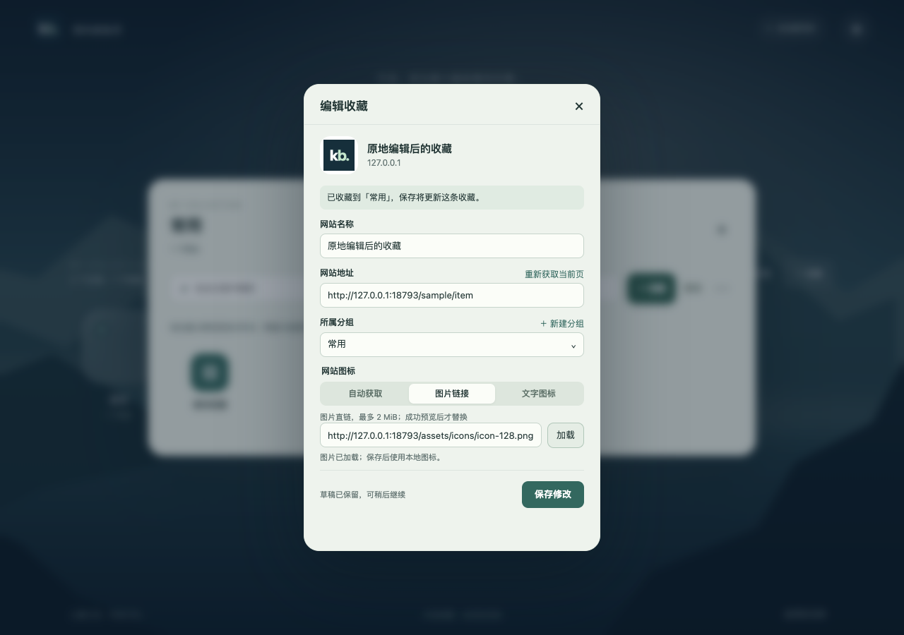

# 收藏保存关闭与原地编辑验收（0.10.1）

日期：2026-10-20。

## 改动

- 工具栏快捷收藏仅在 capture.save 成功响应后调用 window.close；表单无效、保存失败或冲突时保持打开与输入。
- 工作台“编辑图标”使用当前页面的原生 modal + 同源 iframe 复用编辑器，不再调用 chrome.tabs.create。基础表单中的未保存名称、网址和分组按变更字段带入；旧草稿版本继续保留冲突保护。
- 子编辑器成功保存后通知父页面关闭弹窗、刷新卡片并恢复原卡片/搜索框焦点，不会关闭工作台标签页。通信校验 source、origin 和每次打开的随机 channel，忽略其他窗口与迟到的旧消息。
- 使用 showModal、closedby=any 与既有旧版 Chrome 外部点击回退。Esc、关闭按钮和外部点击可取消；子分组下拉优先关闭。保存期间暂时阻止关闭；关闭事件移除 iframe src，取消未完成的编辑器生命周期。
- 无新增权限、数据字段或 NAS 服务改动。

## 验证

Ego TaskSpace 18，loopback 18793，合成收藏。自动脚本 tests/extension/verify_capture_lifecycle.mjs；verify_capture.mjs 保留兼容调用入口。

- 当前工作台原地编辑成功，标签页数量保持 1；基础表单未保存名称带入。
- 图标改为网络图片，取消不改变收藏；再次打开恢复名称与图标草稿。
- 模拟保存响应延迟，关闭按钮禁用、外部点击不关闭；成功后自动关闭，卡片名称/图片即时更新、底层分组保持打开，iframe src 清除。
- 分组下拉打开时第一次外部点击只收起下拉，第二次关闭编辑器。
- 冲突时编辑器保持打开且保留输入，新版本未覆盖；再次明确保存成功后关闭。
- 真正由脚本打开的独立收藏窗口：必填项无效时不关闭；创建与编辑成功后实际关闭窗口；冲突时不关闭。窗口关闭后持久记录可读取且总数无重复增加。
- 同页其他消息来源即使带相同 channel 也不能伪造成功关闭。
- 390×844 弹窗在视口内，无横向溢出；Esc 只关闭编辑器，底层分组保留。
- 103 项 Node 测试、1 项打包白名单测试通过，JS 语法与 git diff --check 通过。

## 发布与原生 Chrome

- 构建 dist/chrome-0.10.1/chrome-kb 与 chrome-kb-0.10.1.zip，归档 SHA-256 abd7680baf506b9dc9e47a3fae1e837700fe8c9e3cf23f5c08abd5aeef63b954。
- 更新 dist/chrome-kb 前备份至 /private/tmp/kb-installed-before-inline-capture-0101；安装目录 43 项白名单摘要核对通过。
- 实际 Chrome 执行 runtime.reload 后，工具栏弹窗与“打开工作台”正常。在真实工作台打开已有收藏的“编辑图标”，确认显示同页 iframe 编辑器；焦点进入子输入框后按 Esc，关闭消息生效并返回原卡片。恢复普通模式并关闭分组回首页。
- 真实收藏未执行测试保存，仍为 15 个分组、101 个收藏；保存自动关闭与故障场景在隔离环境完成验证。
- Ego 0.6.0.12 提示有可用更新，本次未升级。
