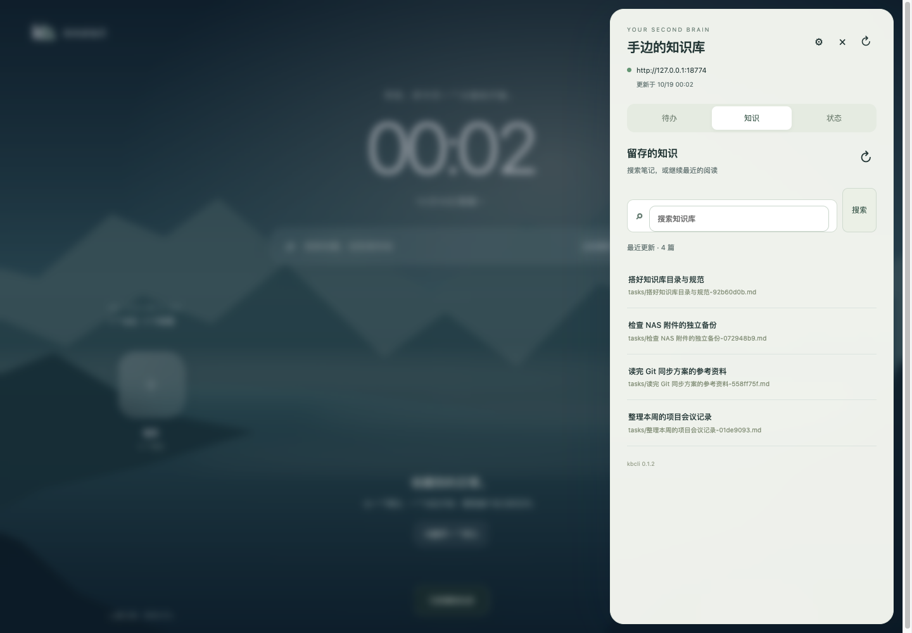
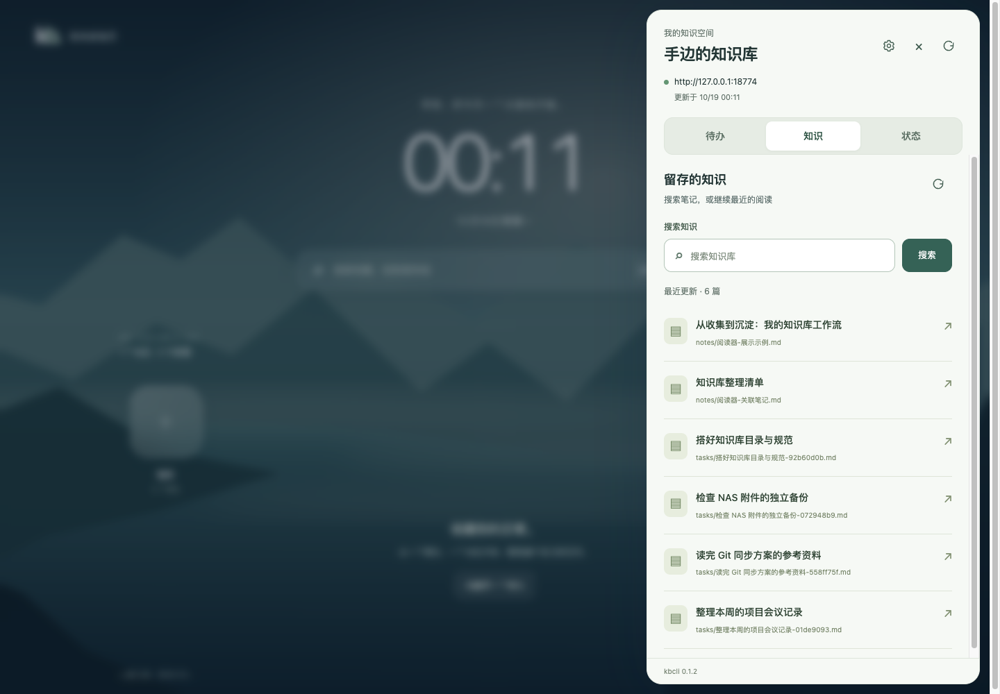
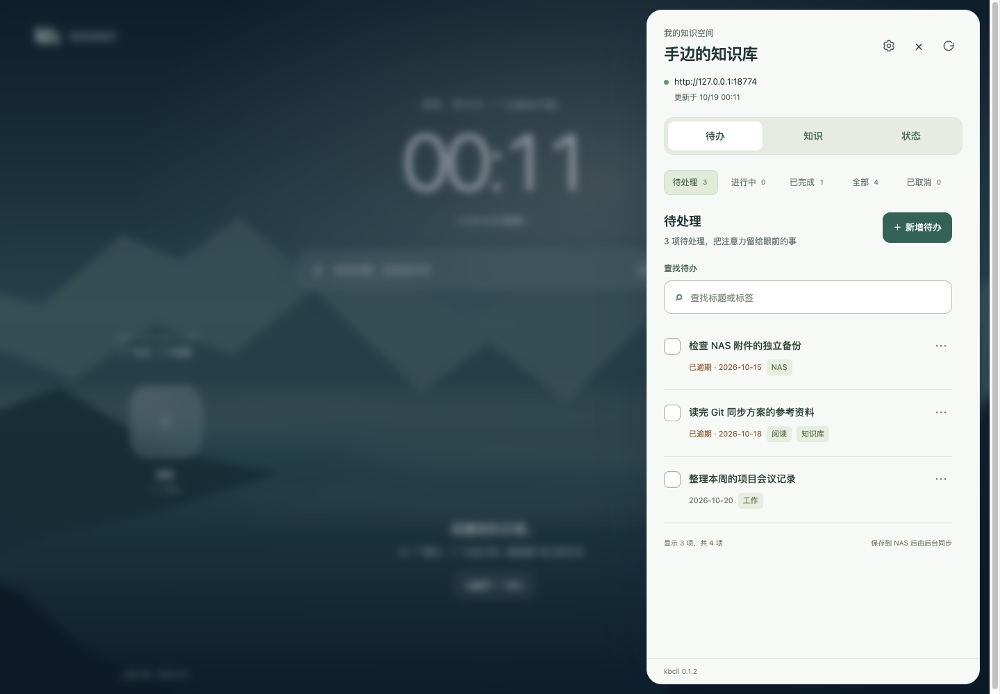
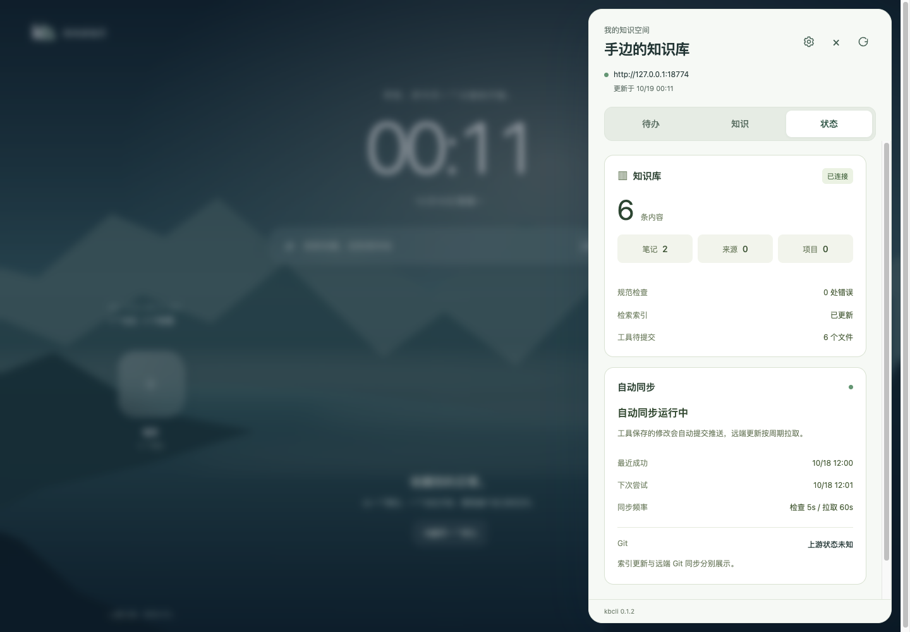
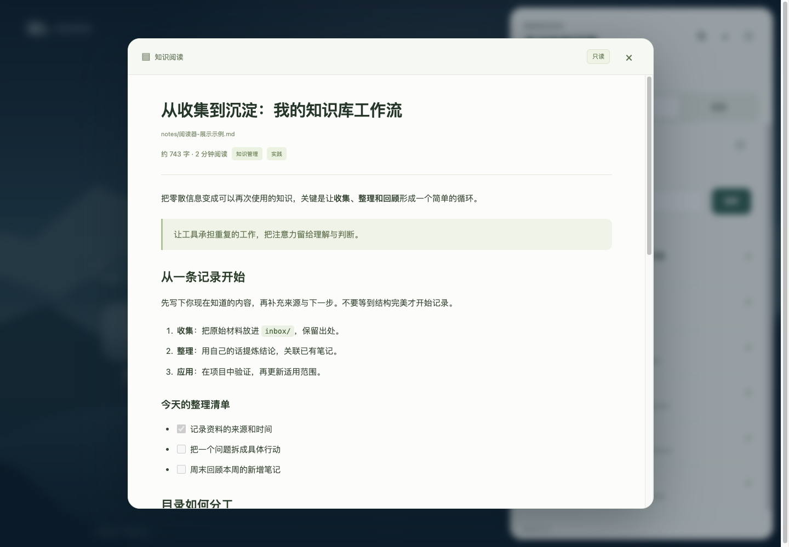

# 抽屉细节与 Markdown 阅读 0.4.0

日期：2026-10-19。本轮修改 Chrome 插件及隔离测试，不修改 NAS 服务或正式知识库。

## 截图分析与修正

知识页的搜索标签匹配了通用 form 字段样式，外层搜索容器和内层 input 同时出现边框，标签外边距又抬高了整行，导致按钮与文字位置不协调。修正时从通用规则排除搜索组合控件，统一外层与按钮为 48px，内层 input 不再带额外边框或外边距，并增加可见字段标签。

待办页的筛选文字、数量和行内操作尺寸较小，五个筛选容易折成孤立一行。本轮统一为五列筛选，提高任务标题、日期和标签可读性，扩大触控区域；新增按钮与标题对齐，列表操作保持原有文件哈希及冲突保护。

状态页区分知识库统计与自动同步信息，增加数值层级、字段间距、长值换行和状态说明。连接、页签固定在抽屉顶部，服务版本固定底部，长内容独立滚动；切换页签保留各自滚动位置，主页布局不变。

同时修复外观监听绑定到 html[data-theme] 的问题：只监听实际主题按钮，避免普通页面点击触发 appearance.update，也不再把 aria-pressed 设置到根元素。

## 只读文章阅读

点击知识列表直接打开居中的原生模态弹窗；正文按 Markdown 展示，顶部工具条固定，正文独立滚动。关闭按钮、Escape、外部点击均可关闭最上层文章，并返回知识列表入口。

- 支持标题、强调、删除线、引用、有序/无序列表、只读任务清单、表格、代码块、段落和链接。
- Front matter 不混入正文，同名首标题不重复展示；标题、路径、标签和阅读长度在独立页头显示。
- 相对 .md 链接在知识库范围内继续阅读；外链仅允许无内嵌凭据的 HTTP/HTTPS，并使用 noopener/noreferrer。
- 本地附件显示未接入提示，外部图片仅显示显式查看链接，不自动加载；数学公式、Mermaid 与原文 HTML 不执行。
- 不提供文章编辑或保存入口。任务清单复选框禁用，文档读取只走已有 knowledge.read GET；待办页的用户操作继续单独受控。
- 正文只存在页面内存。关闭或连接变化立即清空，未完成请求的迟到响应不重新打开文章。

本地解析器固定为 [markdown-it 15.0.3](https://github.com/markdown-it/markdown-it/tree/15.0.3)，导入官方自包含浏览器 ESM 包；来源、哈希及完整依赖许可证随仓库保留。解析器关闭 HTML，渲染层按固定标签白名单创建 DOM，文本通过 textContent/createTextNode 写入，不使用 innerHTML、iframe、eval 或远程脚本。

## 验证

- Node：44 项插件测试通过，覆盖 Markdown 解析、Front matter、重复标题、危险 URL、相对路径、超长文档，以及既有数据与关闭保护。
- Python：发布包白名单测试通过；Ruff 通过。
- 浏览器使用本机真实隔离 kbcli 接口与仅供测试的 Chrome API shim，复用 tests/extension/verify_reader.mjs。
- 1440px 检查搜索按钮/输入框同高对齐、无双边框、筛选同排；文章相对于页面可用宽度居中。
- 检查表格、引用、代码和三个禁用的任务复选框；原文 HTML 作为文字显示，没有 script/img/iframe 或事件属性，没有外部资源请求。
- 库内链接可继续阅读，关闭恢复列表焦点；阅读请求没有触发文章写入或无关 appearance 保存。
- 文章及抽屉工具条滚动时保持位置，390px 窄屏没有页面横向溢出；表格和代码在自身区域滚动。
- 人为延迟文档读取并先关闭弹窗，响应返回后不重新展示文章。

浏览器证据是页面与真实隔离接口的联调，不替代真实 Chrome 扩展安装和主机权限弹窗验收。截图内容均为合成测试资料。

## 安装包

版本 0.4.0，目录 dist/chrome-kb，归档 dist/chrome-kb-0.4.0.zip；旧版 0.3.1 目录及 ZIP 保留。19 项资源与源码及哈希清单一致，包含本地解析器及许可证，不包含测试 shim、示例文章、凭据或用户数据。

SHA-256：4c00655febd98974b344cfc5e703fc8df18a50249684d0d896ee13d2cbcb7254
