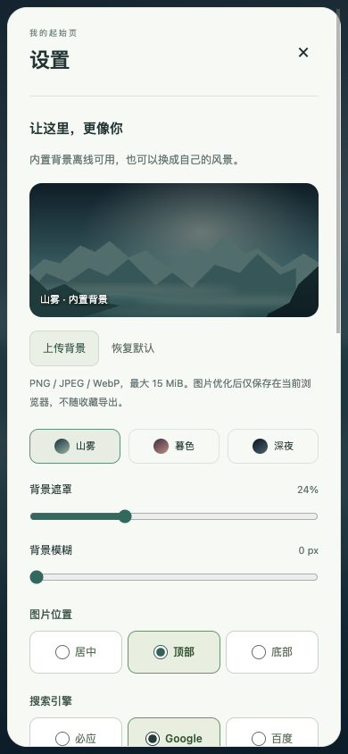

# 设置真实点击验收 0.4.1

日期：2026-10-19。用户反馈设置的图片位置、搜索引擎无法用鼠标正常选择。

## 修复

此前对选择器的自动化主要使用 selectOption，能验证值和保存结果，但绕过了原生菜单的实际指针操作，不能证明用户能完成选择。本轮先实际点击旧控件，记录两个原生 select 的打开状态与截图，再修复交互路径。

图片位置和搜索引擎各只有三个固定选项，改成 fieldset/legend 与原生 radio 组成的直接点选控件。整个标签均可点击，选中状态同时有原生圆点、边框与字重标识；不用浏览器原生下拉弹层，也不引入自定义下拉组件或新的浏览器 API。保留原 appearance 的 position/engine 字段与版本保护，旧设置无需迁移。

保存期间仍防止重复写入，完成后在适当情况下恢复原控件焦点，连续方向键选择可用。收藏偏好保存只禁用所属三个开关，避免意外干预时钟等外观控件。

## 实际操作验证

可复用场景 tests/extension/verify_settings.mjs 使用 ego-browser，连接 127.0.0.1 隔离 fixture。所有设置变更来自 page.click、mouse.click、键盘或实际文件选择，不用 selectOption、直接赋值、合成 change 或 runtime 消息捷径。

- 鼠标依次点击顶部、底部、居中，以及 Google、百度、必应；核对界面选中、持久化值、页面效果和抽屉仍打开。
- 六个选项的 change 均记录 isTrusted=true；两次方向键连续选择通过。
- 实际点击三个主题、两条背景滑轨、时钟，以及新标签页打开、知识库入口、紧凑布局开关，逐项检查保存及恢复。
- 点击上传背景并通过文件选择器选取测试截图，验证优化保存，再点击恢复默认。
- 点击导出下载备份，再通过导入文件选择器选取该文件，验证合并结果；不导出 NAS 配置或背景图片。
- 实际点击连接表单输入和连接按钮，使用隔离服务的测试用户令牌；重新打开设置后点击断开，验证清除连接。
- 刷新恢复选中值；第二标签页读取一致，修改后同步呈现。
- 390px 下实际点击位置与搜索引擎，检查选择和无横向溢出。

Node 插件测试 44 项、Python 白名单打包测试 1 项通过，git diff --check 通过。页面仍由 Chrome API shim 配合真实隔离 kbcli 接口验证，不等于原生扩展安装或权限弹窗验收；没有访问或修改正式 NAS。

## 安装包

dist/chrome-kb 与 dist/chrome-kb-0.4.1.zip 已生成，19 项资源与源码及哈希清单一致。旧版 0.4.0 目录和 ZIP 保留。

SHA-256：39fb4c3b95de44ca95bd4721bbf781b8d8915d983f8c529932fb64f7c65d18e5

提交整理时仅清理依赖许可清单的末尾空行并重新构建；整理前的同版本目录和 ZIP 保存在 dist/before-github-0.4.1。上述哈希对应最终提交内容构建的安装包。
