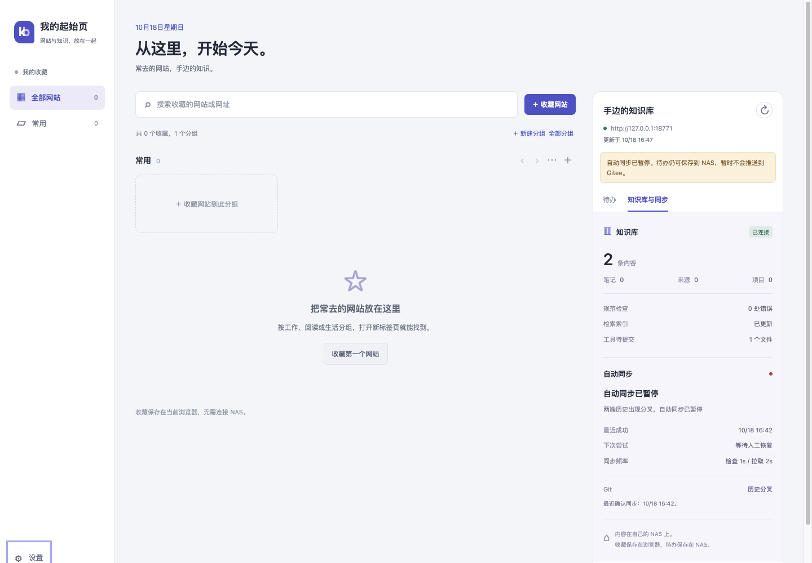

# NAS 数据拆分与独立镜像验收

验收日期：2026-10-18，Asia/Shanghai。软件版本 kbcli 0.1.2，插件 0.2.1。部署方法与回滚见 [NAS 部署](../nas-deployment.md)。原始配置、日志、完整数据备份和模型测试会话仅保留在 NAS 的库外受限目录中。

## 已完成

- 第一阶段在原镜像下拆分知识库、API 状态、调度状态、客户端和服务凭据，再验证运行。
- 第二阶段将 API 与调度器切换到 `kbcli:0.1.2-nas1`，Hermes 继续使用原固定 digest 的镜像。
- 新镜像 ID（docker image inspect .Id）：`sha256:4a70bcc8209bfa79203d18853c4bfbd7a6d777e2cb5cbc5e5d1573c71e6655fb`。Docker images 显示约 375 MB，原 Hermes 镜像约 4.5 GB；镜像基于固定 digest 的官方 Python slim，运行 UID/GID 10000。
- API 不再挂载整个 hermes-data，调度器不再挂载知识库、SSH 或 Hermes 数据；实际 statvfs 验证只读/可写范围与配置一致。
- 原 API 用户/agent 令牌未重新生成；调度 env 仅保留用户令牌。SSH 文件逐字节与停机备份一致，未输出凭据。

## 数据保留与正式链路

一致备份在停止调度、API 与 Hermes 后生成，包含完整 hermes-data、原 Compose 和外部 env（若存在）。原知识库含 .git 整体移动，没有重新 clone，也没有强推、reset 或覆盖内容。

- 原 88 个非 .git 文件逐一与备份核对相同；操作日志在第一阶段恢复同步前逐字节一致。
- 正式知识库仍为 5 条记录、规范错误 0、1 条任务；Git HEAD 保持 `8a69f7b4429f20cabf9eaf097c88bf47a728ed87`，工作区干净，与远端前后差均为 0。
- 原先未暂停；两次迁移均只创建并解除本次专用的 OPERATOR_PAUSED 标记，解除前执行 resume 的恢复条件校验。最终正式调度为 idle，持续产生成功同步时间，无暂停标记。
- 用新镜像挂只读知识库和 SSH 目录，实际访问原 Gitee remote；用插件原 controller/api 代码经 NAS 局域网地址，只读验证用户身份、任务、知识库和同步状态，令牌不进入输出。

## 功能验证

| 项目 | 结果与范围 |
| --- | --- |
| 三个正式服务健康 | healthy，原 API 地址和端口不变 |
| Hermes 配置 | config check 通过，原模型配置保持 |
| Hermes 同步状态兼容 | 原 status/health 路径改为 agent 只读 API 客户端，现场 status 通过；pause/resume 仅管理员宿主机入口 |
| Hermes 实际工具调用 | 单轮受限验收真实调用 status --portable 和 task list，2 条工具结果已从该验收会话记录确认 |
| 新镜像数据写入 | 临时知识库新增与完成通过 |
| 自动提交推送、周期拉取 | 新镜像 API + worker + 本机 bare 远端 + 两个副本，完整双向通过 |
| 身份与复核 | agent 无法完成待办；用户完成保留 pending 审核状态 |
| 分叉与重启 | 隔离两端产生不同提交后 SYNC_CONFLICT 持久暂停；两端 HEAD 保留，重启仍保留原暂停标记 |
| 插件正式客户端连接 | 插件原消息控制器连接正式 NAS API，版本、5 条记录、1 条任务、idle 状态通过 |
| 插件页面交互 | 插件原界面和 Chrome API shim 连接 NAS 上独立镜像的隔离 API，新增、修改、日期清除、完成、状态展示和关闭时令牌输入清理通过 |
| 本地回归 | Ruff 通过；84 项 Python、30 项 Node 测试通过 |

所有写入、分叉和故障测试都使用 NAS 上独立测试目录和本机 bare Git 远端，没有向正式知识库或 Gitee 写测试记录。正式 Gitee 链路使用既有自动同步与只读核验。隔离测试特意保留分叉，以下截图的暂停是测试库状态；正式库为 idle。

## 清理与边界

临时隔离 API/worker 容器、测试端口及本机测试代理均已关闭，隔离目录与报告保留供核查。NAS 禁用 SSH TCP 转发，本轮未更改 SSH 策略；页面测试临时使用仅含测试令牌的隔离 LAN API，随后移除容器关闭端口。

页面验证仍采用测试用 Chrome API shim，不宣称验证了原生 Chrome 的安装/权限弹窗。本次正式 API 地址和令牌保持不变，原扩展授权范围无需因数据迁移而改变。生产库无需新增测试内容；Hermes 日常技能包保持原客户端版本兼容使用，没有把软件迁移写成知识记录。
